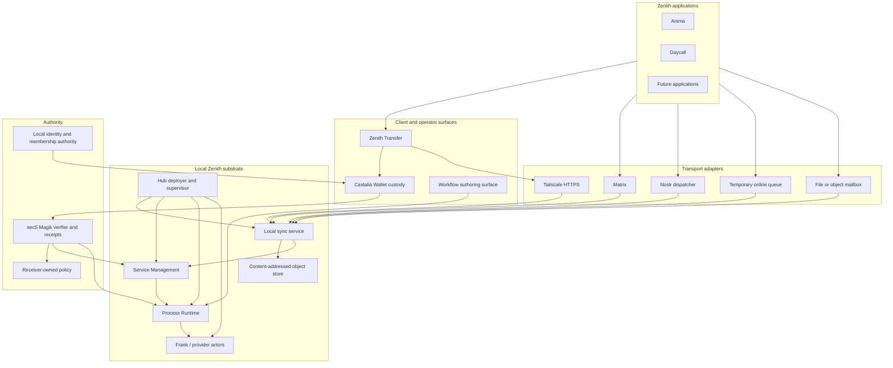
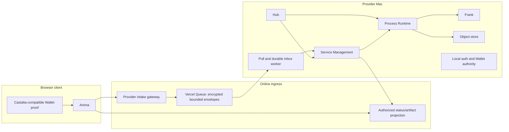

# Zenith Application Substrate v1

Decision date: 2026-10-22
Status: reconciled architecture baseline; implementation is incomplete
Composition owner: Zenith Hub
Initial application pilots: Anima and Daycall

## 1. Objective

The Zenith Application Substrate is the local-first system that makes Zenith
applications operational without requiring each application to implement its own
identity custody, provider discovery, workflow engine, service-request lifecycle,
peer synchronization, receipts, deliverable storage or local deployment stack.

Hub installs and composes the substrate. Zenith Transfer configures trusted
connections, authority and synchronization. Applications such as Anima and
Daycall consume provider-neutral contracts and present an experience appropriate
to their domain.

The first production slice is:

> An Anima browser client discovers a Zenith service contract, submits a reviewed
> structured request through a public bounded intake, the provider Mac pulls and
> durably records it before acknowledgement, Service Management admits it exactly
> once under native authority, and the client reads authoritative status and
> deliverable receipts. A later slice publishes and executes a namespaced workflow.

This is an architecture target, not a claim that every component is implemented
or qualified today.

## 2. Product definition

The substrate is not one application or one shared database. It is a compatible
set of independently owned components and versioned protocols:

| Plane | Responsibility | Primary owner |
| --- | --- | --- |
| Composition | Install, configure, start, stop, update and diagnose the local stack | Hub / lightweight deployer |
| Connection | Discover resources, join trusted private networks, review peers and manage access | Zenith Transfer |
| Identity | Create or restore keys, protect custody, issue and attach credentials | Castalia Wallet and the selected local authority |
| Authorization | Verify exact subject, audience, operation, resource, expiry, replay and policy | secS Magik plus receiver policy |
| Workflow | Import, validate, compile, publish and execute immutable process versions | Process Runtime |
| Service delivery | Own ServiceRequests, Cases, plans, provider obligations and runtime handoff | Service Management |
| Execution | Claim and complete typed work and produce artifacts and execution receipts | Process Runtime and providers such as Frank |
| Synchronization | Replicate versioned records and content-addressed objects between authorized peers | Shared sync protocol, deployed by Hub and operated through Transfer |
| Application | Compose domain-specific intake and render provider projections | Anima, Daycall and later Zenith applications |

## 3. Architectural principles

1. **Local authority remains local.** Application databases, signing custody,
   replay state and provider execution remain under the operator's control.
2. **Shared protocols replace shared databases.** Peers exchange versioned
   records and immutable objects; they do not mirror SQLite files or arbitrary
   directory trees.
3. **Every canonical fact has one owner.** Synchronization distributes facts but
   does not reinterpret or assume ownership of them.
4. **Network reachability is not application authority.** Tailscale can make a
   peer reachable. It does not authorize a workflow publication, service request,
   Case transition or process execution.
5. **Transport acknowledgement is not domain completion.** Matrix event IDs,
   Nostr event IDs, queue acknowledgements and sync cursors are not evidence that
   Service Management admitted a request or that Runtime completed work.
6. **Executable workflow structure is explicit.** Prose may document or propose a
   workflow, but only reviewed structured process data may become executable.
7. **Immutable versions cross boundaries.** Published workflows, artifacts and
   receipts are identified by exact version or content digest.
8. **Applications remain replaceable clients.** Anima and Daycall may shape the
   experience without embedding provider execution or becoming receipt authorities.
9. **Additive compatibility is the default.** New record types and optional fields
   use explicit versions. Unknown required versions fail closed.
10. **Claims follow evidence.** Installation, reachability, authorization,
    persistence, service admission, execution and delivery are reported separately.

## 4. Logical architecture



## 5. Physical deployment

The initial deployment contains a browser client, a bounded online relay and one
provider Mac. The queue is transport, never canonical service state:



The provider Mac needs no public inbound endpoint for this slice. A later
authorized peer-sync path may use Zenith Transfer over Tailscale for supported
records and objects. Public intake and client projection never become the
canonical Service Management database.

## 6. Canonical ownership

| Data | Canonical owner | Replicated form |
| --- | --- | --- |
| Workflow draft source | Authoring owner | Markdown bytes plus provenance and digest |
| Published workflow version | Process Runtime | Immutable pin and compiled snapshot |
| Provider/service description | Publishing provider | Versioned provider contract projection |
| Service request and Case | Service Management | Redacted versioned projection and domain receipt |
| Process run, Attempt and output | Process Runtime | Redacted projection and execution receipt |
| Artifact bytes | Publishing object store | Content-addressed bytes or immutable external reference |
| Transport state | Transport adapter | Bounded transport acknowledgement only |
| Browser custody | Castalia-compatible browser wallet | Encrypted origin-bound local record; never synchronized as plaintext |
| Membership or organization credential | Issuing authority | Verifiable issued credential reference |
| secS admission/operation receipt | secS receiver | Signed receipt or verified public audit projection |

An incoming replica may update a local projection only after schema, ownership,
version, digest and authority checks. It never writes another component's
canonical tables directly.

## 7. Workflow authoring and publication

Process Runtime already accepts bounded JSON, Markdown and plain text. Markdown
contains exactly one standalone `process-json` block; surrounding prose is
non-executable documentation. Import records source provenance and uncertainty.
Compilation validates the typed DAG and produces a deterministic hash. Explicit
publication creates an immutable version.

The substrate standardizes the application flow:

```text
Markdown specification
  -> proposed or edited process-json
  -> schema and DAG validation
  -> visual graph and semantic diff
  -> explicit publication approval
  -> immutable namespaced ProcessVersion
```

An assisted editor may propose structured process data from prose. The proposal
cannot become executable while parser uncertainty, schema errors, type errors or
unreviewed authority requirements remain.

Runtime releases need not contain the complete workflow catalog. A release may
include an optional hash-pinned starter pack. Installing a pack makes its source
available for review and import; it does not automatically publish or execute it.

New workflows use namespaced identifiers such as:

- `zenith.standard.personal-review`
- `zenith.standard.development-sop`
- `zenith.anima.brand-package`
- `zenith.daycall.<workflow>`

Existing unnamespaced identifiers retain their historical meaning. Renaming them
creates new identities rather than rewriting retained pins.

## 8. Synchronization and delivery adapters

### 8.1 Participation modes

There are two materially different participants. They share record and object
semantics, but they do not share a network topology.

**Full-stack peers** run the local substrate: sync service, object store, local
authority, Service Management where applicable, and the components needed for
their role. Two full-stack peers may communicate directly over an authenticated
private route such as Tailscale HTTPS. Each side validates and durably commits an
offered record or object before acknowledging it.

**Clients and intermittently connected applications** are not peers merely
because they can author a draft or display a projection. A browser does not run a
sync daemon, join the provider tailnet, expose an inbound port, own provider
authority or retain peer cursors for the provider's canonical state. It sends or
pulls through an adapter: a bounded online queue, Matrix, Nostr, or an explicitly
configured file/object mailbox. The local substrate consumes that adapter and
applies the same validation and durable-commit rules used for a peer offer.

An installation may move from client mode to full-stack peer mode later without
changing the identity of retained requests, records or immutable objects.

### 8.2 Transport-neutral adapter ports

The sync service owns one transport-neutral inbox/outbox boundary. Concrete
adapters do not write component databases and do not reinterpret domain state.
The conceptual operations are:

```text
capabilities and health
publish immutable envelope or object reference
poll after opaque cursor
fetch immutable object by digest
acknowledge only after durable local commit
reconcile an unknown publication or acknowledgement
```

These names describe behavior rather than approved endpoint or schema names.
The contract implementation must define exact versioned wire schemas and limits.
Every adapter must preserve the same stable logical identity, idempotency key,
content digest, sender/receiver binding, expiry and opaque reconciliation token.

Adapter acknowledgements mean only that the adapter accepted or removed an item.
They never imply ServiceRequest admission, Case creation, Runtime execution,
artifact publication or membership issuance.

### 8.3 Replicated records and objects

Version 1 is bounded synchronization for supported application records and
content-addressed objects. It is not general filesystem synchronization.

Each peer maintains:

- immutable objects addressed by SHA-256;
- versioned metadata records;
- an append-only change feed;
- one retained cursor and acknowledgement state per authorized peer;
- explicit tombstones for supported deletions;
- bounded reconciliation evidence.

The logical peer operations are:

```text
status
list changes after cursor
read immutable object by digest
offer immutable object
submit versioned change
acknowledge durably applied change
reconcile an uncertain submission
```

Exact endpoint names and JSON schemas belong to the sync-contract implementation
issue. The contract must bind at least namespace, record type, stable record ID,
revision, operation, content digest, media type, origin, predecessor where
applicable, and recorded time.

For a client mailbox, the same model is expressed as immutable envelopes,
manifests and blobs rather than a continuously reachable peer feed. A local
consumer derives its own cursor and acknowledgement state from the adapter.

### 8.4 Conflict policy

There is no generic last-write-wins rule.

- Immutable versions conflict if the same identity names different bytes.
- Source-owned projections accept only monotonic revisions from their owner.
- Caller-authored drafts use explicit expected revisions.
- Concurrent changes with no declared merge rule stop reconciliation and remain
  visible for application-level resolution.
- A tombstone cannot silently erase an immutable receipt or published workflow.

### 8.5 Public intake transport

The first external request path uses Vercel Queues poll mode. The public gateway
validates size, schema, stable request identity and provider routing, then emits a
bounded `service.intake-envelope.v1`. The envelope uses X25519, HKDF and
ChaCha20-Poly1305; its authenticated public header binds the recipient key ID,
expiry, ephemeral key and nonce, while canonical `service.intake.v1` bytes and
exact requester evidence remain encrypted. The provider Mac polls with an OIDC
credential held outside the browser and passes the opaque envelope to the
content-pinned `secs-provider-intake-v1` executable. secS retains the canonical
recipient key and returns one closed bounded frame. Service Management then
verifies requester membership separately, commits the exact request and evidence
to a local durable inbox, and only then acknowledges the queue delivery. Queue
delivery is at-least-once, so every retry preserves the same request and
idempotency IDs.

The envelope primitive, browser producer and fixed-purpose macOS opener are
source-qualified in secS PR #302 at
`a6cda6d99a8f8674c1264dd4258ddf16f9a048fc`. Service Management PR #1 at
`434f3cb04f8e494fb87317647fe5f2a6e5e41515` implements the bounded gateway,
separate request/reference Queue paths, native opener, durable local admission
and production Vercel route mapping. They remain dependencies of the target
release until merged, published as reviewed artifacts and pinned in the Hub
composition; source qualification alone is not installed qualification.

The initial choice is based on an implemented official poll SDK and documented
off-platform consumers. The existing Nostr material is design documentation and
does not yet provide a qualified exact-recipient dispatcher or credential path.

### 8.6 Direct full-stack peer synchronization

Tailscale HTTPS is the planned first direct transport between full-stack peers.
Zenith Transfer already contains an embedded private-network session and a
fail-closed URLSession route on iOS. The sync implementation must reuse that route
and add a supported Mac/provider route. Loss of the private network cancels active
requests; there is no direct-network fallback.

Tailscale membership proves neither Wallet identity nor application permission.
Recurring reads use receiver-issued scoped credentials where supported. Privileged
mutations use the appropriate Wallet/secS authorization bound to the exact
operation and resource.

Direct synchronization starts with one owner-declared record family and immutable
objects between two Macs. It does not begin with arbitrary directory mirroring.
The receiving peer lists changes from its retained cursor, fetches missing blobs
by digest, validates owner/revision/authority, commits locally, and then advances
the cursor. Snapshot/reseed is explicit when retention has elapsed.

### 8.7 Client mailbox and message adapters

Matrix, Nostr, temporary queues and user-selected storage are adapters to the same
logical records:

- Matrix may carry encrypted assets and notifications.
- A backend Nostr dispatcher may carry encrypted pending envelopes using its own
  scoped service transport identity.
- A temporary online queue may hold a bounded encrypted envelope while a local
  authority is offline.
- A local folder, Dropbox folder, WebDAV location or compatible object store may
  act as an explicit mailbox. The adapter writes immutable, content-addressed
  payloads and a bounded manifest; it never assumes identical filesystem paths.
- A Zenith-hosted mailbox may offer the same contract for a client that does not
  run a local stack. It stores ciphertext and bounded routing/retention metadata,
  not canonical Service, Runtime or identity state.

Their acknowledgements remain transport facts. Pull, validate, commit locally and
deduplicate before acknowledging consumption. Transport retries retain the same
logical request identity and content digest.

Large assets need not pass through the message body. The message or envelope may
carry an immutable object descriptor whose location is explicitly allowed by the
receiver. The receiver streams with size limits, verifies the exact digest before
commit, and treats a missing or changed object as unavailable. A URL, Matrix event
or Dropbox path is not itself an artifact receipt.

Adapters have narrow credentials for their own medium. A Matrix access token,
Nostr dispatcher key, Dropbox token, object-store credential or Queue OIDC token
does not grant membership, organization authority, workflow authority or provider
execution.

### 8.8 Delivery sequence

Synchronization is delivered in layers:

1. Keep the current Vercel Queue request/reference adapters and read-only response
   projection as the first provider proof.
2. Extract their stable identity, cursor, acknowledgement and reconciliation
   behavior behind the transport-neutral ports without changing wire bytes.
3. Qualify one direct Tailscale peer adapter between two full local stacks for one
   supported record family and content-addressed objects.
4. Add one message adapter and one file/object mailbox adapter only when a real
   application needs them. Matrix is the leading message candidate; a local folder
   is the smallest storage candidate. Dropbox, Nostr and a hosted mailbox remain
   replaceable adapters rather than mandatory substrate dependencies.
5. Add broader record families, reseed, multi-peer operation and application-level
   conflict resolution after the two-peer path is reliable.

Steps three through five are not prerequisites for the first Anima provider
delivery. The first provider implementation must preserve the adapter boundary so
it does not hard-code Vercel Queue as the only future transport.

## 9. Service delivery

The provider-neutral service path is:

```text
provider/service discovery
  -> reviewed structured request and artifact manifests
  -> receiver authorization
  -> ServiceRequest admission
  -> qualification and acceptance
  -> Case and approved immutable process pin
  -> ProcessRun and provider execution
  -> committed artifacts and receipts
  -> synchronized projections and deliverable manifests
```

Service Management remains the only canonical owner of ServiceRequests and Cases.
Process Runtime remains the owner of runs, Attempts, outputs and execution
receipts. An application or transport adapter cannot infer Case creation or
completion from liveness or message delivery.

The first reference service is `zenith.anima.brand-package`. It must enter with
real structured inputs and produce reviewable artifacts; starting an empty
process is not acceptance.

## 10. Receipts and work graph

The system retains distinct evidence:

1. transport acceptance;
2. secS verification/admission or rejection;
3. durable local inbox commit;
4. Service Management domain transition;
5. Runtime execution transition and output commit;
6. artifact publication and retrieval;
7. peer synchronization and acknowledgement.

secS Magik is the common machine-operation verification and attestation layer. It
does not become the Service Management database or invent service state. A global
work-graph projection may index signed canonical facts and their relationships,
but cannot reinterpret a pending outbox receipt as external delivery or execution.

## 11. Identity and enrollment

Anima and other applications may create or restore a Castalia-compatible local
identity before the local authority is online. Browser custody reuses the existing
closed `castalia.web-wallet.v1` record and trusted encryption/recovery behavior.

The lifecycle is:

```text
local encrypted identity
  -> local draft association
  -> separate pending-registration outbox record
  -> local authority verifies and registers the same public key
  -> client validates and attaches the issued credential
  -> optional session and separate organization/provider authority
```

Private root material, recovery data and passphrases never enter the sync feed,
queue, Nostr payload, Matrix message or logs. A pending registration must not be
represented as membership. Email verification, Matrix login, transport signing,
membership, web sessions and organization authority remain separate states.

Browser custody is origin-bound. Select a canonical trusted Zenith custody origin
and use explicit cross-origin proof or connection; subdomains do not share
IndexedDB implicitly. Cookies, when present, contain only opaque server-issued
session handles.

## 12. Storage model

- Component databases remain private and component-owned.
- The sync store retains validated records, immutable objects, peer cursors and
  reconciliation state outside source/release directories.
- Large assets may remain in Matrix, a content-addressed store, a CDN or direct
  peer storage; manifests bind exact bytes, media type and location metadata.
- Paths are local implementation details. Protocol records use stable identities
  and content digests rather than assuming identical filesystem layouts.
- Secrets and plaintext custody do not enter shared storage.
- Backups preserve canonical databases, sync state and object manifests while
  keeping authority activation and Wallet recovery as explicit ceremonies.

## 13. Application-level SLA boundary

SLA policy is intentionally deferred. Applications and providers need experience
with real requests, review, delivery and exception handling before freezing SLA
semantics. Runtime and sync contracts retain stable service, Case, run, artifact
and receipt references so a later versioned application commitment can point to
them without changing execution history.

No SLA schema, timer engine or breach rule is a v1 release gate.

## 14. Failure and recovery semantics

- Unknown transport outcomes reconcile the original request; they do not create a
  new logical request.
- A sync cursor advances only after durable local application.
- Corrupt or missing objects stop the dependent record from becoming available.
- A peer that misses retention must perform an explicit bounded snapshot/reseed.
- Revoked or expired authority prevents new mutations even when data is reachable.
- Restart preserves canonical state, replay protection, sync cursors and pending
  reconciliation.
- Conflicts and unsupported versions remain visible and block the affected record;
  they are never silently discarded.
- Offline applications may continue local drafting. They cannot claim server
  admission, issued membership or completed delivery while the authority is down.

## 15. Compatibility and release composition

Hub releases pin exact compatible component artifacts and protocol versions.
Workflow packs are separately identified inputs. A bundle installation does not
activate authority, publish workflows, register providers or enable external
effects.

Each producer must ship consumer fixtures for shared contracts. Stored records
use read-old/write-new migrations where possible. Breaking semantics require a
new schema identifier and explicit migration or continued parallel reader.

## 16. Security invariants

- No private Wallet key or passphrase crosses a sync boundary.
- No Tailscale auth key is retained in application records or logs.
- Tailscale loss cannot fall back to public networking silently.
- TLS, peer discovery and Tailscale membership do not replace application
  authorization.
- Incoming records are untrusted bytes until bounded schema, digest, ownership,
  authority and version checks pass.
- Synchronization never writes component databases directly.
- Applications cannot submit directly to Process Runtime for managed services.
- Matrix, Nostr, email and typed identity metadata grant no runtime authority.
- Published workflow pins and receipts are immutable.

## 17. Explicit non-goals for v1

- General-purpose filesystem synchronization.
- Collaborative live document editing.
- A shared cloud database for all Zenith applications.
- Automatic merging of divergent canonical records.
- Automatic authority creation or activation during installation.
- Mandatory wallet installation before public drafting or ordinary Matrix use.
- Per-user personal Nostr identities for backend dispatch.
- A full SLA engine.
- Windows, Linux desktop or Intel Mac support in the first release.
- Automatic publication of every bundled workflow.

## 18. Open decisions

The implementation plan must resolve these through bounded issues rather than
guessing inside code:

1. Which existing workflow editor is current and whether it can consume the
   Process Runtime authoring contract.
2. The repository/package boundary for the later shared sync implementation.
3. Initial object-size limits and when direct peer transfer yields to an external
   encrypted object location.
4. Exact source-ownership and merge policy for each synchronized record type.
5. Provider Mac Tailscale serving and certificate profile for the later sync slice.
6. The canonical browser custody origin and cross-origin proof flow.
7. Which standard workflows belong in the optional starter pack.
8. How redacted domain receipts are exposed to clients before Runtime receipts gain
   a native signature field.
9. The first supported retention/reseed policy for intermittently connected peers.
10. Vercel project, Queue region, retention and spending owner for production intake.
11. Authorized client status/artifact storage and query boundary.
12. The released secS identity and artifact digests that carry the reviewed
    request/reference envelope producers and provider opener.

## 19. Acceptance boundary

The first production-slice claim requires all of the following on exact installed
artifacts and deployed resources:

- clean macOS Apple-silicon installation without a developer checkout;
- an Anima client consuming the versioned provider-neutral contract;
- a deployed bounded gateway and queue with no browser-held provider credential;
- authenticated encrypted queue transport and separately verified membership;
- a real structured brand-package ServiceRequest admitted exactly once;
- authoritative client status plus receipt/deliverable references;
- queue redelivery, lost acknowledgement, restart and unknown admission outcomes
  reconciled without a duplicate ServiceRequest;
- altered bytes, wrong result binding, revoked authority, replay and unsupported schemas
  rejected without canonical mutation;
- the released Mac runtime running the same path under native authority.

The broader substrate v1 claim then adds a published namespaced workflow, pinned
Runtime execution, Frank artifacts, peer synchronization over Tailscale, and a
second application (initially Daycall) using the same contracts.

Source tests, a running health endpoint, queue acceptance, Tailscale reachability, a Matrix event or
the presence of a document do not independently satisfy this boundary.
