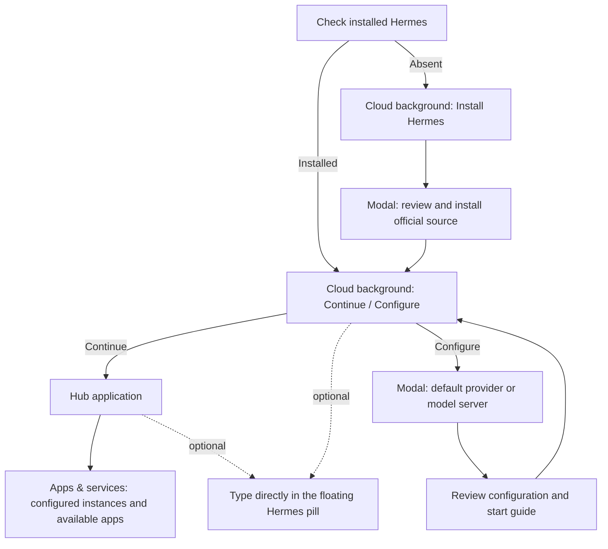

# Welcome and Hermes setup flow

November 23, 2026. Current flow after review of installation, entry, modal disclosure and the compact chat composer.

## Entry and configuration

Hermes installation is the prerequisite for the normal cloud entry screen. Installed software does not imply that a model provider is configured.

**Continue** opens `/hub`. It shows Conversations and Work; **Settings & configuration** is at `/settings`. It requires an installed Hermes, with no provider sign-in or chat test as an entry gate. The initial Continue and secondary Configure controls sit directly on the cloud background. When Hermes is absent, Install Hermes occupies the same background action area. No initial card or modal is shown.

An explicit Install, Configure, installation-selection or retained-progress action opens one native modal over the persistent artwork. Install review, installation selection, model configuration and operation progress remain inside that dialog. Closing it retains applied work and setup drafts; it discards only an unapplied review plan. Completing install or setup returns to the background actions. The dialog places focus on Close, contains keyboard focus and restores the activating control on dismissal. It can be closed while applied work continues; View progress reopens it. No previous wizard page is embedded.

Configure edits Hermes's default main model slot without creating a `hub-guide` profile or selecting profile templates. For Hub-installed Hermes it uses the instance's `data` directory. A detected installation can be explicitly bound to its existing default configuration after a review. The legacy `create-guide-profile` action identifier accepts an additive, reviewed `defaultConfiguration: true` mode for that binding; older clients and saved named-profile bindings retain their original behavior. No arbitrary configuration-home path is accepted from the browser. Provider configuration, the model helper and gateway all resolve the same server-validated home. Existing credentials, history and unrelated settings remain in place.

## Install and configure

The install review shows the official NousResearch source, recorded revision and private destination. Runtime, exact hashes, ports and dependency details expand in place. Download/build operations begin only after reviewed Apply. The clean-machine installer prepares a pinned vendor Python bootstrap rather than requiring Homebrew.

Configuration offers three native-backed paths: AI provider; guided open model chosen using actual machine fit and free space; or existing model server. Provider sign-in/key entry is explicit. A model list is a selection aid, not proof of a successful response. Model downloads disclose size and occur only after reviewed Apply.

The reviewed setup action prepares the private API if needed, applies the selected backend and starts the guide. It checks authenticated health and capabilities. An already-enabled default API with a different owner key blocks setup rather than being replaced. Installation, backend configuration, current availability and successful reply evidence remain separate facts.

## Floating composer

Once a guide is configured, the globally available control starts collapsed as a glass circle containing only the status dot. Clicking it opens the glass message-input pill with a latest-response toggle and send arrow. Typing alone does not send a model request. Enter or the send arrow submits once.

While Hermes is replying, an animated border travels around the glass input; no waiting-text card is shown. The minimized dot carries the same loading border. Reduced motion uses a static outline, and assistive technology receives the busy state. The border stops when the response or error arrives.

Only the latest assistant reply appears above the input, in a glass panel without a heading, role labels, connection banner or user transcript. Its visible reading interval is the reply's word count at 80 words per minute (750 ms per word), followed by a 400 ms fade. Punctuation and whitespace do not add reading time. A new request clears the old reply; its result replaces it. Minimization and hidden tabs pause the reading clock. The caret can reopen the latest reply with a fresh reading interval. Reduced motion keeps the reading interval and removes the opacity transition.

The leading status dot minimizes the guide, preserving the draft and remaining reply time; the circle carries no chat icon. The glass fill, blur, grain and inset highlights follow zenith-landing's GlassBox. Reply glass uses a darker blue tint over the artwork to retain text contrast, and dark text on light application/modal surfaces. Escape first hides a visible reply, then collapses an input-only pill. Busy/offline states disable sending while retaining the draft. A failed request restores the attempted text if the owner has not typed a new draft.

An optional successful reply saves verification evidence bound to the selected source/model/credential generation. Entry remains available independently of that evidence or later service outages. The latest-reply display survives normal Hub navigation; native Hermes retains its own conversation records independently. While the welcome modal is open, the same guide component moves into its interaction layer. Its draft, latest reply and circle/input state survive opening and closing; there is no duplicate composer or chat CTA. Closing welcome restores it to the global layer.

## Page context in Hermes messages

At send time, the Hub appends the current page title, pathname, visible main content
and selected option labels after the owner's question. An open modal supplies the
active context. Chat, hidden content, text-entry values (including contenteditable
editors), sign-in codes, query strings and fragments are excluded.

Appended page text is capped at 10,000 characters; the combined request is capped
at 16,000. The 4,000-character question allowance stays intact. The existing v1
message string and native Hermes interface are reused. Context is labeled as
reference data, and the guide retains disabled tool execution.

This is the approved MVP context bridge. The inline TODO calls for better agent
context injection and generalized secS inputs for agent and non-agent receivers.
See [the scope and compatibility record](page-context-review.md).

## Recovery and compatibility

- Read-only discovery never executes the launcher or adopts an existing profile. Fresh managed receipts resolve their source/environment/tools directly; Continue verifies the pinned copy independently of any guide, named profile, provider or reachable API. Registration attaches that exact inspected copy to the existing Hub instance, and later observations retain its binding.
- Unsupported detected software is reported as installed with a compatibility explanation.
- Review plans bind the state and source/adapter pins. Expired reviews recheck in place.
- Retained long operations are reconciled before mutation; a browser timeout does not imply cancellation.
- Backend/credential changes invalidate chat verification without revoking installation or Hub entry.
- Older v1 receipt paths and successful-chat evidence remain readable. The new entry timestamp is additive.
- Final reusable components live in zenith-ui-deployment before dependent Hub commits.

Bootstrap still clones and launches the released Hub only. No Matrix, Devgraph or SAI resource is created by entering the Hub or opening the composer.

## Artwork replacement plan

The welcome surfaces now render the code-native scene described in the [background recreation roundtable](background-rebuild-plan.md). Its custom glyphs and central plaque remain fixed while outer cloud groups drift slowly. Setup, active guide use, document visibility and reduced-motion preference govern pauses. The original bitmap remains reference evidence, with no runtime image dependency.

## Settings & configuration

The existing gallery is now Settings & configuration at /settings. Apps &
services is its current section, retaining configured instances, available apps,
inline configuration and the accessible refresh icon. It reads the same setup
and external connection records without introducing a resource graph index.

Continue opens the main /hub workspace. Older /hub?matrix=INSTANCE links forward
to /settings?matrix=INSTANCE. Configuration prompts open the relevant saved
instance or catalog setup form. No setup, account, credential or instance
migration is required.

See the [main Hub implementation record](main-hub-screen-plan.md) for Conversations,
Work and their current client/data limits. The earlier
[gallery rollback record](resource-gallery-rollback-2026-11-22.md) remains
historical evidence.
