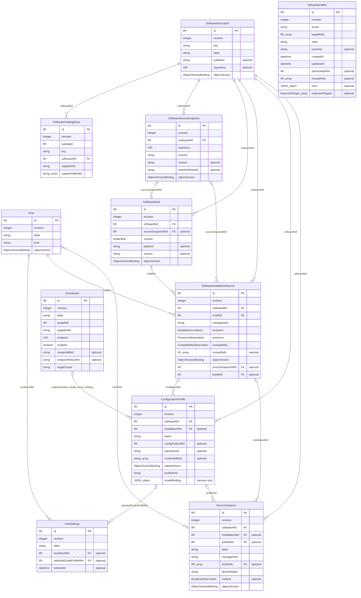
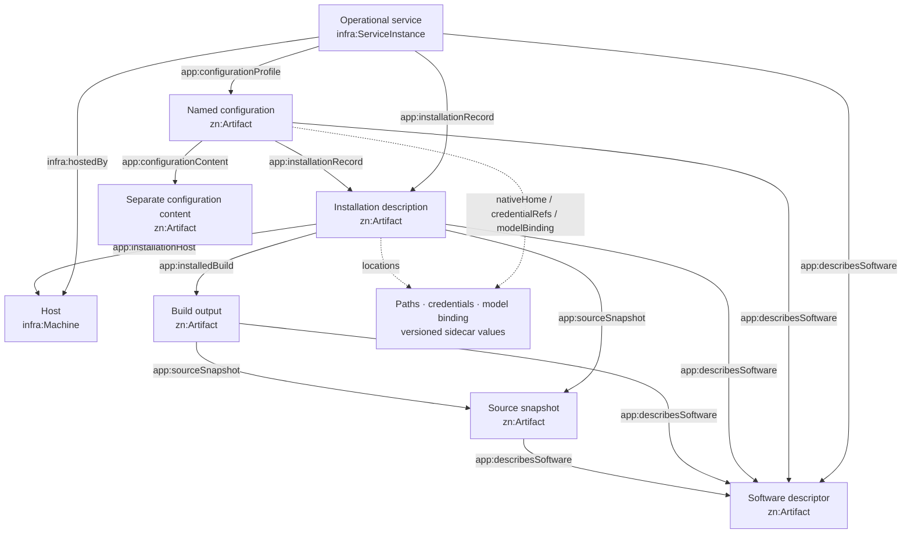
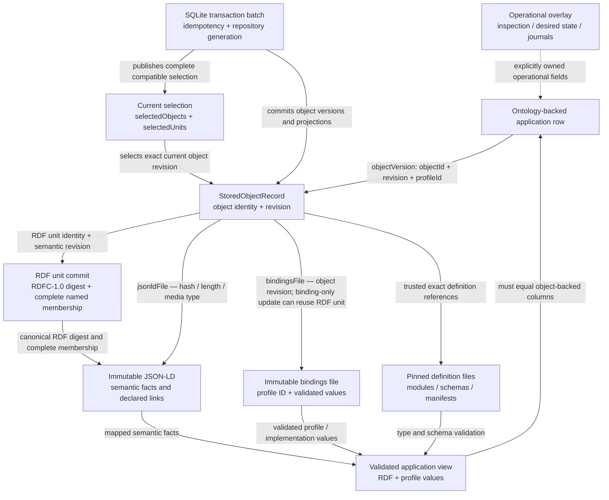

# Hub database and ontology diagrams — draft 5

Review-only. A shows application records/projections; E is the chosen physical SQLite DDL, not a live migration. Current snapshots cannot mix RDF unit revisions; transaction batches are separate. All classes are existing Core or proposed Infrastructure; the new app vocabulary declares properties only and is not registered/published. Observation admission only.

## A — Application database / logical relational projection

Edges are application references, not inheritance. Object-version links are expanded in D. Embedded arrays/objects remain JSON values in this logical view. Catalog IDs identify application catalog configuration; generic target/plan/receipt/evidence references follow typed local/external resolution rules.

## B — Ontology inheritance / existing Core + proposed Hub Infrastructure

```mermaid
flowchart TB
    Thing["owl:Thing"]
    zn_Entity["zn:Entity"]
    zn_Person["zn:Person"]
    zn_Organization["zn:Organization"]
    zn_Agent["zn:Agent"]
    zn_Artifact["zn:Artifact"]
    zn_ExternalLink["zn:ExternalLink"]
    zn_Receipt["zn:Receipt"]
    zn_Event["zn:Event"]
    zn_Domain["zn:Domain"]
    zn_Collection["zn:Collection"]
    zn_Handoff["zn:Handoff"]
    zn_Actor["zn:Actor"]
    infra_Machine["infra:Machine"]
    infra_ServiceInstance["infra:ServiceInstance"]
    infra_Deployment["infra:Deployment"]
    infra_Network["infra:Network"]
    infra_NetworkInterface["infra:NetworkInterface"]
    infra_StorageVolume["infra:StorageVolume"]
    infra_DNSZone["infra:DNSZone"]
    CoreModule["Core module — existing"]
    InfraModule["Infrastructure — proposed / unpublished"]
    AppRelations["Application relations — REVIEW ONLY / properties, no classes"]
    Thing -->|"parent → subclass"| zn_Entity
    zn_Entity -->|"parent → subclass"| zn_Person
    zn_Entity -->|"parent → subclass"| zn_Organization
    zn_Entity -->|"parent → subclass"| zn_Agent
    Thing -->|"parent → subclass"| zn_Artifact
    Thing -->|"parent → subclass"| zn_ExternalLink
    zn_Artifact -->|"parent → subclass"| zn_Receipt
    Thing -->|"parent → subclass"| zn_Event
    Thing -->|"parent → subclass"| zn_Domain
    Thing -->|"parent → subclass"| zn_Collection
    zn_Artifact -->|"parent → subclass"| zn_Handoff
    zn_Actor -.->|"owl:equivalentClass"| zn_Entity
    zn_Entity -->|"parent → subclass"| infra_Machine
    zn_Agent -->|"parent → subclass"| infra_ServiceInstance
    Thing -->|"parent → subclass"| infra_Deployment
    Thing -->|"parent → subclass"| infra_Network
    Thing -->|"parent → subclass"| infra_NetworkInterface
    Thing -->|"parent → subclass"| infra_StorageVolume
    Thing -->|"parent → subclass"| infra_DNSZone
    InfraModule ==>|"owl:imports"| CoreModule
    AppRelations -.->|"proposed import"| CoreModule
    AppRelations -.->|"proposed import"| InfraModule
```

## C — Semantic RDF relationships / schema roles, not ontology subclasses

Nodes are application schema roles with ontology types, not new ontology classes. Solid arrows are RDF predicates; dashed arrows are sidecar implementation bindings.

## D — Revision ledger / opt-in foundation

## E — Proposed physical SQLite schema

Foreign-key dependencies from the exact design DDL; optional and conditional reference semantics remain governed by the repository contract. These are tables, not ontology classes.

```mermaid
erDiagram
    hub_adapter_bindings {
        TEXT handle PK
        TEXT owner_id
        TEXT adapter_ref
        TEXT binding_json
    }
    hub_catalog_entries {
        TEXT id PK
        TEXT kind
        TEXT catalog_id
        TEXT catalog_key
        TEXT software_id
        TEXT adapter_ref
        TEXT supported_modes_json
    }
    hub_commits {
        TEXT id PK
        TEXT idempotency_key
        TEXT request_sha256
        INTEGER generation
        TEXT result_json
        TEXT committed_at
    }
    hub_connections {
        TEXT id PK
        TEXT kind
        TEXT label
        TEXT target_id
        TEXT target_scope
        TEXT adapter_ref
        TEXT endpoint
        INTEGER enabled
        TEXT credential_ref
        TEXT endpoint_policy_ref
    }
    hub_current_objects {
        TEXT object_id PK
        INTEGER object_revision
        TEXT unit_id
        INTEGER unit_revision
    }
    hub_current_units {
        TEXT unit_id PK
        INTEGER unit_revision
    }
    hub_definition_pins {
        TEXT set_id PK
        TEXT kind PK
        TEXT iri PK
        TEXT file_sha256
    }
    hub_definition_sets {
        TEXT id PK
        TEXT manifest_sha256
    }
    hub_files {
        TEXT sha256 PK
        TEXT storage_key
        INTEGER byte_length
        TEXT media_type
    }
    hub_identity_aliases {
        TEXT namespace PK
        TEXT alias_key PK
        TEXT target_id
        TEXT provenance_sha256
    }
    hub_inspection_associations {
        TEXT inspection_id PK
        TEXT installation_id
        INTEGER object_revision
        TEXT commit_id
    }
    hub_inspections {
        TEXT id PK
        TEXT software_id
        INTEGER software_revision
        TEXT host_id
        INTEGER host_revision
        TEXT source_id
        INTEGER source_revision
        TEXT build_id
        INTEGER build_revision
        TEXT subject_kind
        TEXT candidate_id
        TEXT copy_identity
        TEXT inspected_installation_id
        INTEGER inspected_installation_revision
        TEXT fingerprint_sha256
        TEXT scope_key
        INTEGER scope_complete
        TEXT observed_at
        TEXT valid_until
        TEXT boot_id
        TEXT adapter_digest
        TEXT state
        TEXT reasons_json
        TEXT proof_json
        TEXT proof_sha256
        TEXT commit_id
    }
    hub_installation_state {
        TEXT object_id PK
        TEXT kind
        TEXT management
        TEXT presence_json
        TEXT compatibility_json
        TEXT latest_inspection_id
        TEXT receipt_refs_json
    }
    hub_legacy_imports {
        TEXT source_namespace PK
        TEXT source_key PK
        TEXT source_sha256 PK
        TEXT result_json
        TEXT commit_id
    }
    hub_object_identities {
        TEXT id PK
    }
    hub_object_type_history {
        TEXT object_id PK
        INTEGER object_revision PK
        TEXT type_iri PK
    }
    hub_object_versions {
        TEXT object_id PK
        INTEGER object_revision PK
        TEXT unit_id
        INTEGER unit_revision
        TEXT jsonld_sha256
        TEXT bindings_sha256
        TEXT definition_set_id
        TEXT admission
        INTEGER legacy_read_only
        TEXT mapping_id
        TEXT mapping_sha256
        TEXT commit_id
    }
    hub_operations {
        TEXT id PK
        TEXT kind
        TEXT action
        TEXT state
        TEXT outcome
        TEXT target_refs_json
        TEXT expected_targets_json
        TEXT plan_artifact_id
        TEXT receipt_refs_json
        TEXT error_json
        TEXT created_at
        TEXT updated_at
    }
    hub_profile_values {
        TEXT object_id PK
        INTEGER object_revision PK
        TEXT profile_id PK
        TEXT value_json
    }
    hub_projections {
        TEXT kind PK
        TEXT object_id PK
        INTEGER object_revision
        TEXT profile_id
        TEXT projected_json
    }
    hub_rdf_links {
        TEXT unit_id PK
        INTEGER unit_revision PK
        TEXT subject PK
        TEXT predicate PK
        TEXT target PK
        TEXT graph PK
    }
    hub_rdf_unit_members {
        TEXT unit_id PK
        INTEGER unit_revision PK
        TEXT object_id PK
    }
    hub_rdf_unit_versions {
        TEXT unit_id PK
        INTEGER unit_revision PK
        TEXT semantic_sha256
        TEXT jsonld_sha256
        TEXT canonical_nquads
        TEXT commit_id
    }
    hub_record_heads {
        TEXT kind PK
        TEXT id PK
        INTEGER revision
    }
    hub_reference_bindings {
        TEXT owner_kind PK
        TEXT owner_id PK
        INTEGER owner_revision PK
        TEXT field PK
        TEXT target_id PK
        TEXT mode
        INTEGER target_revision
    }
    hub_schema_migrations {
        INTEGER version PK
        TEXT ddl_sha256
        TEXT applied_at
    }
    hub_service_state {
        TEXT object_id PK
        TEXT kind
        TEXT management
        TEXT desired_state
        TEXT runtime_json
    }
    hub_settings {
        TEXT id PK
        TEXT kind
        TEXT label
        TEXT local_host_id
        TEXT selected_guide_profile_id
        TEXT entered_at
    }
    hub_setup_drafts {
        TEXT id PK
        INTEGER revision
        TEXT step
        TEXT selection_json
    }
    hub_software_keys {
        TEXT software_key PK
        TEXT object_id
    }
    hub_store_state {
        INTEGER singleton PK
        TEXT repository_id
        INTEGER generation
        TEXT writer_mode
    }
    hub_record_heads ||--o{ hub_catalog_entries : kind_and_id
    hub_current_objects ||--o{ hub_catalog_entries : software_id
    hub_record_heads ||--o{ hub_connections : kind_and_id
    hub_current_units ||--o{ hub_current_objects : unit_id_and_unit_revision
    hub_object_versions ||--o{ hub_current_objects : object_id_and_object_revision_and_unit_id_and_unit_revision
    hub_rdf_unit_versions ||--o{ hub_current_units : unit_id_and_unit_revision
    hub_files ||--o{ hub_definition_pins : file_sha256
    hub_definition_sets ||--o{ hub_definition_pins : set_id
    hub_files ||--o{ hub_definition_sets : manifest_sha256
    hub_files ||--o{ hub_identity_aliases : provenance_sha256
    hub_object_identities ||--o{ hub_identity_aliases : target_id
    hub_object_versions ||--o{ hub_inspection_associations : installation_id_and_object_revision
    hub_commits ||--o{ hub_inspection_associations : commit_id
    hub_inspections ||--o{ hub_inspection_associations : inspection_id
    hub_object_versions o|--o{ hub_inspections : inspected_installation_id_and_inspected_installation_revision
    hub_object_versions o|--o{ hub_inspections : build_id_and_build_revision
    hub_object_versions o|--o{ hub_inspections : source_id_and_source_revision
    hub_object_versions ||--o{ hub_inspections : host_id_and_host_revision
    hub_object_versions ||--o{ hub_inspections : software_id_and_software_revision
    hub_commits ||--o{ hub_inspections : commit_id
    hub_record_heads ||--o{ hub_installation_state : kind_and_object_id
    hub_inspections o|--o{ hub_installation_state : latest_inspection_id
    hub_current_objects ||--o{ hub_installation_state : object_id
    hub_commits ||--o{ hub_legacy_imports : commit_id
    hub_files ||--o{ hub_legacy_imports : source_sha256
    hub_object_versions ||--o{ hub_object_type_history : object_id_and_object_revision
    hub_rdf_unit_members ||--o{ hub_object_versions : unit_id_and_unit_revision_and_object_id
    hub_commits ||--o{ hub_object_versions : commit_id
    hub_files o|--o{ hub_object_versions : mapping_sha256
    hub_definition_sets ||--o{ hub_object_versions : definition_set_id
    hub_files ||--o{ hub_object_versions : bindings_sha256
    hub_files ||--o{ hub_object_versions : jsonld_sha256
    hub_object_identities ||--o{ hub_object_versions : object_id
    hub_record_heads ||--o{ hub_operations : kind_and_id
    hub_object_versions ||--o{ hub_profile_values : object_id_and_object_revision
    hub_profile_values ||--o{ hub_projections : object_id_and_object_revision_and_profile_id
    hub_current_objects ||--o{ hub_projections : object_id_and_object_revision
    hub_record_heads ||--o{ hub_projections : kind_and_object_id
    hub_rdf_unit_versions ||--o{ hub_rdf_links : unit_id_and_unit_revision
    hub_rdf_unit_versions ||--o{ hub_rdf_unit_members : unit_id_and_unit_revision
    hub_object_identities ||--o{ hub_rdf_unit_members : object_id
    hub_commits ||--o{ hub_rdf_unit_versions : commit_id
    hub_files ||--o{ hub_rdf_unit_versions : jsonld_sha256
    hub_object_versions o|--o{ hub_reference_bindings : target_id_and_target_revision
    hub_record_heads ||--o{ hub_service_state : kind_and_object_id
    hub_current_objects ||--o{ hub_service_state : object_id
    hub_record_heads ||--o{ hub_settings : kind_and_id
    hub_current_objects o|--o{ hub_settings : selected_guide_profile_id
    hub_current_objects o|--o{ hub_settings : local_host_id
    hub_object_identities ||--o{ hub_software_keys : object_id
```

