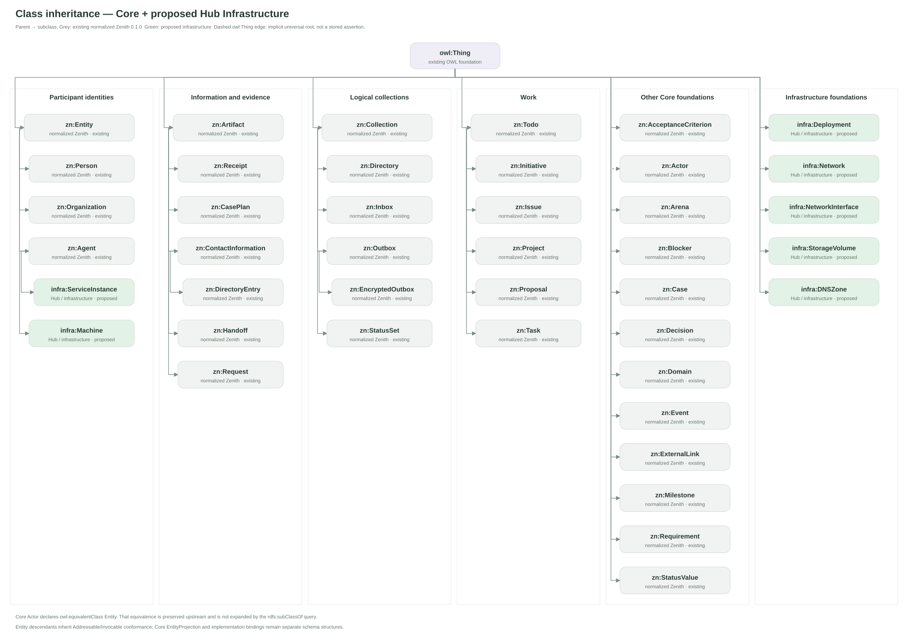
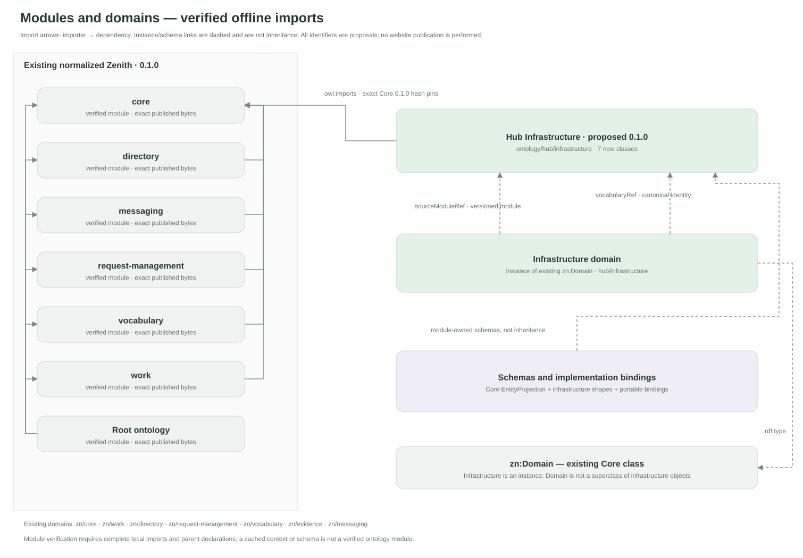

# Hub Infrastructure — implementation review

This is an unpublished Hub-owned extension and follow-up to object-store PR #17.
The implementation remains Node + SQLite. No services are provisioned and no
network, DNS, Tailscale, authority, credential or live-data changes are performed.
The future Rust store is separate work.

## Ownership and semantic decisions

The full IRIs and exact Core dependency pins are in the
[owned package](../../profiles/object-store/ontology/infrastructure/README.md).
Core 0.1.0 is verified from its previously pinned offline release artifacts; its
files, identifiers, schemas and definitions are unchanged. SAI is not vendored
or modified. The website and published releases are untouched.

Infrastructure is represented by an instance of `zn:Domain`, with optional
`sourceModuleRef` pointing to the versioned module and `vocabularyRef` pointing
to its canonical ontology identity. A domain is neither a superclass of its
objects nor a resource collection.

| New class | Parent | Independent meaning |
|---|---|---|
| `infra:Machine` | `zn:Entity` | Physical/virtual compute host participating in the environment |
| `infra:ServiceInstance` | `zn:Agent` | Identified operational software service |
| `infra:Deployment` | `owl:Thing` | Particular service placement/configuration, separate from its manifest |
| `infra:Network` | `owl:Thing` | Connectivity domain |
| `infra:NetworkInterface` | `owl:Thing` | Host/service attachment to one network |
| `infra:StorageVolume` | `owl:Thing` | Identified physical/logical volume, separate from paths/content |
| `infra:DNSZone` | `owl:Thing` | Administrative DNS namespace/authority boundary |

Existing Entity participant semantics, Person, Organization and Agent are retained.
A record describing a Machine is not the Machine and does not turn it into an
Artifact. There are no new Resource, Space, Database, Bucket, Application, API,
Manifest, Event or Receipt classes.

- An application, database server, object-store service or independently operated
  API uses ServiceInstance with an implementation profile. An application's API
  endpoint is just a binding unless it has an independent service identity/lifecycle.
- Logical databases, buckets, Spaces and maintained file/object collections use
  CollectionProfile over `zn:Collection`, with kinds `database`, `bucket`, `space`,
  `file-collection` or `object-collection`. The profile is not another class.
- Manifests, configuration documents, contracts and retained evidence use Artifact.
  Event denotes an occurrence; Receipt is the existing evidence record class.
- A Deployment realizes a ServiceInstance and is hosted on identified compute;
  its manifest is linked using existing `zn:HAS_ARTIFACT`.

## Relationships and constraints

Edges below describe objects; they do not express subclass inheritance. The
manifest records the allowed subject/target classes, with descendant matching.
Known local endpoint types are checked at infrastructure admission. External or
untyped references remain explicitly unresolved; they are never fetched or given
invented types. Later contradictory updates are rejected transactionally if they
would invalidate existing admitted relationship ranges.

| Predicate | Meaning / admitted constraint |
|---|---|
| `infra:hostedBy` | Placement/hosting by a Machine or ServiceInstance; required for ServiceInstance, Deployment and NetworkInterface |
| `infra:realizes` | Deployment → exactly one ServiceInstance |
| `infra:managedBy` | Management responsibility → Entity; grants no authority |
| `infra:attachedTo` | NetworkInterface → exactly one Network |
| `infra:usesInterface` | Machine/service/deployment uses an interface |
| `infra:usesStorage` | Service/deployment/collection uses a StorageVolume |
| `infra:hasMember` | Maintained Collection membership of any identified thing |
| `zn:HAS_ARTIFACT` | Existing predicate reused for manifests, contracts and evidence; target Artifact or subclass |

NetworkInterface has one host and one attached Network. Deployment has one
realized service and may list multiple placement hosts. `infra:dnsName` describes
the DNSZone namespace; server addresses, records, routes and credentials are not
implied. Generic collection membership is scoped to this extension because Core
currently offers artifact membership rather than an unrestricted member predicate.

## Verified module closure

The object catalog now distinguishes generic cached resources from verified
modules. A module must be a manifest-declared, hash-pinned JSON-LD document whose
ontology identity, version IRI and version metadata match the declaration.
`owl:imports` must resolve to other verified local modules, not merely to cached
contexts/schemas. Explicit dependency version/module hash/manifest pins must match.
Each referenced superclass must be available through that module's import closure.
Missing imports, conflicting identities, missing/unimported parents and mismatched
dependencies reject with named errors. Schema references also resolve offline.

The verifier reads RDF facts, so equivalent split JSON-LD descriptions of a class
or module do not bypass validation. Subclass and import traversals are bounded and
cycle-safe. Query expansion/profile inheritance follow explicit `rdfs:subClassOf`
paths only. This does not implement OWL equivalentClass, restrictions, property
chains, satisfiability checks or a general reasoner. Core's Actor equivalentClass
axiom is therefore not expanded by these queries; the inheritance image marks
its universal-root placement as implicit display context.

## Observation versus admitted infrastructure

Ordinary JSON-LD imports remain observation/description storage. An asserted
Machine type, discovery record or known endpoint proves no invocation conformance,
health, authority or reachability. Optional observed-node profiles check the
shape of supplied fields without demanding a complete setup.

Use `admission: "infrastructure"` to request the explicit schema-admission boundary:

1. Required bindings are selected through verified subclass closure. Machine-only
   assertions inherit EntityProjection requirements; ServiceInstance-only assertions
   inherit them through Agent. No ancestor types must be redundantly asserted.
2. Core `core.schema.json#/$defs/EntityProjection` validates unchanged and separately.
   Infrastructure fields never enter its closed `id/types/invocationContract` value.
3. Infrastructure Admitted-node schemas validate the logical record view of explicit
   subject assertions across its selected dataset graphs. This is a validation view;
   named-graph boundaries in authoritative RDF are not changed or inferred.
4. Collection profiles identify Spaces/logical data collections. Management and
   endpoint details use separate ImplementationBinding values. A binding's manager
   cannot reuse its subject identity.
5. Contract references validate the exact Core ArtifactRef shape. Known pinned
   contract content must match its bytes/hash and Core InvocationContract schema;
   declared operation schemas resolve/compile offline. An external contract may
   remain unresolved. Reachability and authorization are always `not-tested`.

Core retains stable logical IRIs and `msg(message) → reply`, declared operations,
typed input/output/error schemas and its Message/Reply identity, retry and retention
semantics. This feature checks declarations and references; it does not implement
receivers or demonstrate behavioral conformance. A management agent can supply a
binding for a machine address while retaining its own separate identity.

An admitted record is not silently downgraded by a later ordinary import. Existing
required bindings remain required. Promoting an observation is a metadata change
requiring its expected revision. Explicit de-admission/authority activation is not
implemented by this proposal.

## Portable bundles

Plain `application/ld+json` remains RDF graph/dataset interchange. It intentionally
does not contain operational profile sidecars. The versioned transport schema
[`object-bundle.schema.json`](../../profiles/object-store/object-bundle.schema.json)
adds a separate portable envelope with:

- Expanded JSON-LD dataset and its RDFC-1.0 digest.
- Explicit projection/implementation bindings and per-object admission states.
- Exact module/package/schema/profile/resource pins needed for offline validation.
- A deterministic transport checksum, distinct from the RDF semantic digest.

Bundle import validates envelope shape, hashes, verified dependencies, graph
identity/types against bindings and required admitted-object projections before
using the existing transactional CAS/idempotency import. It carries no source
record revision counters, provenance, credentials, grants or database files.
Destination revisions are newly assigned; this is not a backup format.

The checksum is not a signature or authorization proof. Supply the source checksum
out of band with `expectedBundleSha256` / `--expected-bundle-sha256` to pin an expected
bundle against changes even if an untrusted sender recalculates its checksum.
Schema/dependency/binding contradictions reject independently. No import fetches
missing modules, contexts, schemas or external contracts.

Object selections include complete shared anonymous units. Graph-selected bundles
must include complete types/bindings and admitted shapes; incomplete selections
reject. Plain graph exports can still represent partial descriptions. Required
contract references survive export/restart/fresh import; unresolved content remains
unresolved and does not turn into evidence of callability.

## API / CLI

Existing local origin/Host/CSRF protections apply before request-body reads. New
operations are additive to `/api/objects`; ordinary operations keep their defaults.

- `GET operation=list&type=IRI&includeSubclasses=true`: explicit bounded subclass
  expansion. Omit it (or use false) for asserted-only behavior. RDF assertions are
  never rewritten with ancestor types.
- `POST operation=import/create/update` can include `admission: "infrastructure"`
  and the existing `projections` map. Existing expected-revision contracts apply.
- `GET operation=export-bundle` accepts the same object/graph selections as export
  and returns `application/vnd.zenith.hub-object-bundle+json`.
- `POST operation=import-bundle` accepts a bundle in `document`, `importKey`, optional
  `expectedRevisions`, `source` and `expectedBundleSha256`. It cannot override the
  bundle's bindings with a second request-side projections/admission map.

Owner CLI, from the Hub checkout, always with a new private test data directory:

```sh
node scripts/objects.mjs import --data-dir /private/owner/Hub-Infra \
  --input profiles/object-store/ontology/infrastructure/examples/connected.jsonld \
  --projections profiles/object-store/ontology/infrastructure/examples/projections.json \
  --admission infrastructure --import-key synthetic-infrastructure-001
node scripts/objects.mjs list --data-dir /private/owner/Hub-Infra \
  --type https://zenith-research.ca/ontology/terms/Entity --include-subclasses true
node scripts/objects.mjs export-bundle --data-dir /private/owner/Hub-Infra \
  --output /private/owner/infrastructure-bundle.json
node scripts/objects.mjs import-bundle --data-dir /private/owner/Hub-Infra-Fresh \
  --input /private/owner/infrastructure-bundle.json --import-key received-001
```

Paths above are illustrative; the automated verifier creates and removes its own
disposable stores. No running demo/provider database is used. The optional Hub
store moves from schema 1 to schema 2 solely by adding a sparse admissions table;
old records remain observations and their assertions/retry receipts are retained.
Only isolated test stores have been exercised here; live migration is not performed.

## Reproduce / package verification

```sh
node scripts/verify-infrastructure.mjs
node scripts/infrastructure-diagrams.mjs
npm run test:objects
npm run build
node scripts/check-object-api.mjs
node scripts/check-object-api.mjs --standalone
```

The normal and standalone package traces include the module, schemas, pins and
examples. An owner-private extension can add its own pinned package locally and
inherit these profiles without copying SAI into the public repo. Tests exercise a
private subclass fixture and reject importing its bundle into a missing catalog.

Only during development of this unpublished owned proposal, refresh its manifest
with `node scripts/refresh-infrastructure-manifest.mjs`. That command refuses a
published/non-owned package and never modifies upstream Core assets. Verification
never refreshes pins automatically.

## Diagrams





## Remaining review decisions

1. Confirm the proposed Hub namespace/version before any publication. No release,
   merge or website change is part of this task.
2. Confirm Deployment's single realized service and NetworkInterface's single
   host/network attachment constraints. Collections group deployments/services.
3. Decide the operational qualification workflow after schema admission: resolving
   external contracts, binding receivers, operation tests, health and permissions.
   Those checks must remain separate from discovery/type recognition.
4. Decide whether generic collection membership should later move upstream. It is
   currently an Infrastructure property; Core is unchanged.
5. Decide whether future portable exchange needs authenticated signing. Current
   integrity checks plus a trusted expected checksum do not create identity/grants.
6. Decide a separate explicit de-admission workflow if admitted objects need to
   become partial observations. Generic updates currently retain admission.
7. OWL equivalentClass and general reasoning remain out of scope. The future Rust
   persistence project is separate from this Node/SQLite demo implementation.
