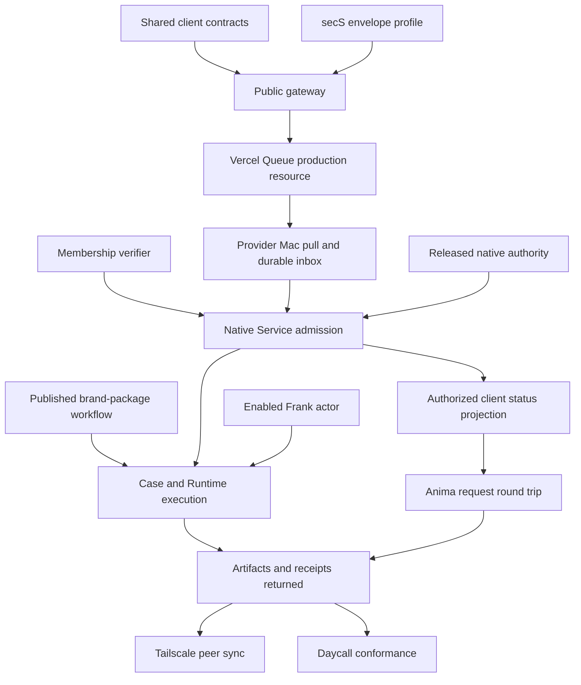

# Zenith Application Substrate v1 delivery plan

Reconciled: 2026-10-22  
Architecture: [Zenith Application Substrate v1](../architecture/zenith-application-substrate-v1.md)  
Tracking status: reconciled with the existing Devgraph initiative and active Work records

## 1. Outcome and present boundary

The immediate outcome is the smallest real provider path that unblocks Anima:

```text
Anima browser
  -> versioned provider catalog and service contract
  -> reviewed brief with stable request/idempotency IDs
  -> bounded public gateway
  -> encrypted Vercel Queue envelope
  -> provider Mac pull and durable inbox commit
  -> separate requester-membership verification
  -> native-authorized Service Management request.create
  -> authoritative status, receipt and deliverable projection
```

Anima remains a replaceable HTML/TypeScript/Rust-WASM client. It does not own or
embed Service Management, Process Runtime, Frank, provider credentials, local
deployment, or canonical service state.

This first slice does not claim workflow execution. The next slice pins an actual
`zenith.anima.brand-package` workflow, creates a Case, runs it through Process
Runtime and Frank, and returns real artifacts. Tailscale peer synchronization and
Daycall conformance follow after that path works.

## 2. Canonical Devgraph placement

Use the existing substrate Initiative and existing provider/service Work. Do not
create a replacement Initiative or recreate equivalent Issues.

The currently active provider boundary is:

- `Issue/provider-service-contract-and-client-projection`
- `Issue/provider-reachable-intake-and-local-admission`
- `Issue/anima-provider-service-client`
- `Task/provider-vercel-encrypted-intake-gateway`
- `Task/provider-local-pull-and-service-admission`
- `Task/provider-authorized-client-status-and-artifacts`
- `Task/provider-anima-brand-package-production-proof`

Historical Mac installation, native authority, live-provider and released-runtime
Work remains evidence and dependency context. Preserve its receipts and do not
mark it complete merely because this sequence supersedes an earlier gate plan.

## 3. Current evidence

### Delivered source contracts

- `@zenith/service-management-client` exposes strict provider catalog, service
  contract, reviewed intake, client projection, deliverable and receipt types.
- Stable request and idempotency identities survive retries.
- Client parsers reject unknown required shapes and preserve opaque server cursors
  and receipt references.
- Exact authorization is an injected callback; transport acknowledgement never
  becomes service progress.
- Anima has consumed the source client and reports its contract/UI checks passing.

### Delivered local admission source

- A bounded public gateway core validates canonical intake, exact idempotency and
  provider routing, verifies requester intent before sealing, and publishes through
  the official Queue SDK with an opaque stable deduplication key.
- `service.intake.v1` closes the request shape and verifies the reviewed brief hash.
- A separate SQLite inbox persists exact intake bytes, requester evidence and the
  transport receipt before acknowledgement.
- Duplicate delivery, acknowledgement loss and process restart retain one logical
  request.
- Requester membership verification, transport opening and Service Management
  command authority are separate ports.
- The retained `service.command.v1/request.create` is stable across an unknown
  Service result and safely reconciles through Service Management idempotency.
- Admission accepts a result only when its command ID and ServiceRequest resource
  match the retained intake.
- Exact intake redelivery cannot replace the retained requester-evidence bytes.
- The optional Vercel poll adapter uses the official Python SDK, deploymentless
  polling, byte transport, bounded batch size and the documented 30–3600 second
  lease range.
- secS PR #301 implements the bounded `service.intake-envelope.v1`, WASM producer
  and fixed-purpose macOS provider opener. The opener owns canonical recipient-key
  custody and returns one closed binary frame.
- Service Management commit `60412b5` content-pins that executable by SHA-256,
  rechecks it for every invocation, supplies no key path or inherited environment,
  and accepts only the exact bounded intake/evidence response.

### Verified limitations

- No Vercel project, production Queue, public gateway or spending approval has
  been provisioned.
- The encrypted queue envelope and native opener are source-qualified in secS PR
  #301 but are not merged, released, installed or exercised through a live Queue.
- The gateway has not yet consumed a released secS WASM producer, and the provider
  contract does not yet publish the reviewed intake key ID, public key and rotation
  window.
- The requester-membership verifier port is not wired to a production Castalia /
  Zenith membership authority.
- Authorized online status and artifact projection storage is not selected.
- The installed Mac bundle is an installation-only base: Service Management and
  Process Runtime are live but report `authority=default_deny`; native authority
  qualification and provider activation remain incomplete in the released path.
- No checked-in `zenith.anima.brand-package` workflow and no qualified Frank actor
  execution currently satisfy the production proof.
- Existing Nostr dispatcher material is design-only and does not provide a
  qualified exact-recipient transport implementation.

## 4. Delivery lanes

### Lane A — Shared client contract

**Owner:** Service Management with Anima as consumer reviewer.  
**State:** source contract delivered; live receiver binding remains.

Acceptance:

1. Catalog and service contract are served from a real provider endpoint.
2. Anima submits the reviewed brief through a replaceable intake client.
3. Status remains explicit: draft, submitting, accepted, qualification needed,
   awaiting information, planned, running, review needed, delivered, rejected,
   failed or unknown.
4. Additional-information and review/approval operations are added only from
   explicit Service Management domain operations, not guessed in the browser.

Reviews: contract compatibility, Anima consumer, untrusted-data UX.

### Lane B — Reachable encrypted intake

**Owner:** provider gateway and Service Management intake adapter.  
**State:** gateway/publisher core and poll consumer implemented; encryption and
native opening source-qualified; release composition and deployment incomplete.

Acceptance:

1. Select one Vercel project, region, retention, consumer group and spending owner.
2. Implement the bounded gateway with no provider or Queue credential in Anima.
3. Reuse secS Magik primitives in one versioned encrypted-envelope profile.
4. Bind provider, service, request, idempotency, expiry and ciphertext digest.
5. Provider Mac polls off-platform with OIDC, commits locally and only then
   acknowledges.
6. Replay, expiration, altered ciphertext, wrong recipient, queue redelivery and
   lost acknowledgement leave canonical Service state correct.

Reviews: transport security, cryptography/interop, reliability, operations/cost.

### Lane C — Native local admission

**Owner:** Service Management and secS Magik authority.  
**State:** durable/idempotent core and native envelope adapter implemented;
production membership and Service-authority issuers remain incomplete.

Acceptance:

1. Wire the real membership verifier to receiver-owned policy.
2. Wrap the existing native authority ingress as the concrete Service command port.
3. Run the worker from Hub with owner-only configuration and durable state outside
   source/release directories.
4. Prove restart, process death, unknown command outcome, revoked membership and
   default-deny behavior on the installed Mac bundle.

Reviews: authority, Service domain, storage/recovery, release composition.

### Lane D — Authoritative client projection

**Owner:** Service Management projection boundary.  
**State:** schemas/fixtures delivered; online service incomplete.

Acceptance:

1. Choose the smallest authoritative online projection store or gateway query path.
2. Authenticate the requesting wallet/member without leaking provider credentials.
3. Publish only Service-owned request/Case state and referenced Runtime/artifact
   evidence.
4. Preserve unknown outcomes, cursors and receipt types; never infer progress from
   Queue, Matrix or HTTP liveness.
5. Demonstrate isolation between two requesters and denial after authority expiry.

Reviews: privacy/authorization, API contract, projection truthfulness, recovery.

### Lane E — First useful workflow and release proof

**Owner:** Process Runtime, Frank, Hub and service operators.  
**State:** blocked by released-runtime authority/provider gap and missing workflow.

Acceptance:

1. Author `zenith.anima.brand-package` as reviewed Markdown plus explicit
   structured process data.
2. Publish an immutable process version without rebuilding the runtime bundle.
3. Convert one real ServiceRequest to a Case pinned to that version.
4. Run typed work through an enabled Frank/provider actor and commit real artifacts.
5. Return exact Service, Runtime and artifact receipts through the client projection.
6. Repeat from the clean released installer on the operator Mac.

Reviews: workflow/DAG, service delivery, creative deliverables, independent source,
installed release and recovery.

### Lane F — Later peer and application reuse

**Owner:** Zenith Transfer and application adapters.  
**State:** deliberately after the production slice.

Acceptance:

1. Define supported records/objects, source ownership, cursors and conflicts.
2. Qualify direct Tailscale synchronization between authorized peers.
3. Add Zenith Transfer install/configuration only after standalone installation
   and service delivery pass.
4. Make Daycall consume the same client contracts without Anima-specific fields.

## 5. Dependency graph



Contract, encryption-profile, membership-verifier and released-runtime work can
proceed independently. A paid/deployed Queue is needed only when the gateway and
consumer are ready for the live proof.

## 6. Gates

### Gate 1 — Contract-ready

- Anima consumes the canonical package and fixtures.
- Provider catalog, intake and projections are versioned and strict.
- No client embeds provider authority or execution.

Current assessment: **source-complete; live endpoints incomplete**.

### Gate 2 — Reachable and durable

- Gateway, encrypted envelope and Queue are deployed.
- Provider persists exact intake/evidence before acknowledgement.
- Duplicate delivery and restart prove one logical request.

Current assessment: **local gateway/consumer core passes; deployment and
released encryption artifacts and deployment open**.

### Gate 3 — Native-authorized admission

- Real membership verifier and native Service authority are active.
- One external request becomes exactly one canonical ServiceRequest.
- Wrong subject/resource, expiry, replay and unknown outcome are safe.

Current assessment: **core binding implemented; released adapters not qualified**.

### Gate 4 — Client-visible round trip

- The submitting member can read authoritative state and receipt references.
- Cross-request access is denied.
- Anima renders real server states without inventing progress.

Current assessment: **schemas ready; online projection absent**.

### Gate 5 — First useful delivery

- A real brand-package Case runs the exact published workflow.
- Frank/provider actors commit reviewable artifacts and receipts.
- Anima retrieves them through the shared contract.

Current assessment: **not started on released artifacts**.

### Gate 6 — Reusable substrate

- Clean installer reproduces the result.
- Zenith Transfer adds the qualified installation/configuration path.
- Tailscale synchronization and Daycall use the same protocol families.

Current assessment: **later work**.

## 7. Immediate engineering sequence

1. Merge secS PR #301, publish reviewed WASM and macOS artifacts, and record their
   exact digests and contract versions.
2. Extend the provider contract with the signed intake key ID, public key,
   envelope profile and validity/rotation window; wire Anima only to that public
   metadata and a configurable gateway URL.
3. Wire the released WASM sealer into the bounded gateway and implement the
   production Zenith membership verifier with negative tests.
4. Implement the authorized status/artifact boundary against local fakes; keep
   cloud resource identifiers injectable.
5. Select the Vercel project, region, retention and spending owner, then provision
   only the minimum Queue, OIDC and gateway resources.
6. Compose the Hub release with the pinned native opener, explicitly provisioned
   provider key, poll worker, durable inbox and production Service authority issuer.
7. Run the public request round trip into native-authorized Service Management and
   expose its exact authoritative projection to Anima.
8. Close the remaining released Runtime/provider gap and repeat from the clean
   installer.
9. Author, publish and execute `zenith.anima.brand-package` with real inputs, then
   return artifacts/receipts to Anima and record exact evidence in Devgraph.
10. Begin Tailscale peer synchronization, Zenith Transfer installation and Daycall
    reuse only after Gate 5.

## 8. Evidence rules

Every completion receipt records the exact repository revision, schema versions,
test command, installed artifact hash where relevant, negative-path result and
known limitations. Queue acknowledgement, Devgraph outbox status, HTTP liveness,
Matrix delivery and source tests remain separate facts. No gate advances on task
count or documentation alone.

