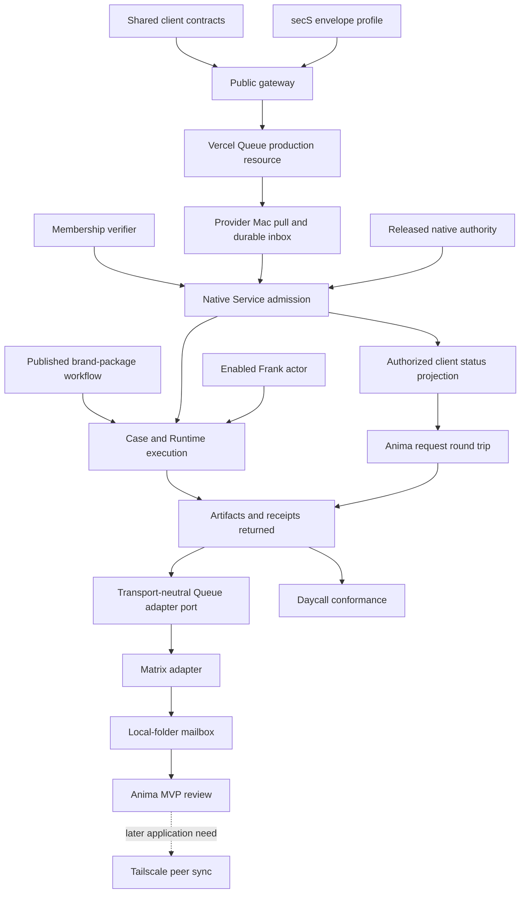

# Zenith Application Substrate v1 delivery plan

Reconciled: 2026-10-22  
Architecture: [Zenith Application Substrate v1](../architecture/zenith-application-substrate-v1.md)  
Tracking status: reconciled with the existing Devgraph initiative and active Work records

## 1. Outcome and present boundary

The immediate outcome is the smallest real provider path that unblocks Anima:

```text
Anima browser
  -> versioned provider catalog and service contract
  -> reviewed brief with stable request/idempotency IDs
  -> bounded public gateway
  -> encrypted Vercel Queue envelope
  -> provider Mac pull and durable inbox commit
  -> separate requester-membership verification
  -> native-authorized Service Management request.create
  -> Case pinned to zenith.anima.brand-package
  -> Process Runtime / Frank execution and human review
  -> authoritative status, artifact, receipt and deliverable projection
```

Anima remains a replaceable HTML/TypeScript/Rust-WASM client. It does not own or
embed Service Management, Process Runtime, Frank, provider credentials, local
deployment, or canonical service state.

Anima also does not traverse a local synchronization service by default. It calls
the configured Service Management intake boundary directly. On a full local node,
Zenith Transfer composes Castalia Wallet custody and may run a separate optional
sync/mailbox sidecar. The sidecar reports synchronization state and handles only
explicit replication or mailbox routes.

The reviewed source chain now includes the workflow, Runtime handoff, Frank input
hydration and artifact materialization. Production qualification still requires
merging and releasing those exact sources, deploying the transport and authority,
and running one substantive request through human review and returned artifacts.
Direct peer synchronization and Daycall conformance follow after that path works.

## 2. Canonical Devgraph placement

Use the existing substrate Initiative and existing provider/service Work. Do not
create a replacement Initiative or recreate equivalent Issues.

The currently active provider boundary is:

- `Issue/provider-service-contract-and-client-projection`
- `Issue/provider-reachable-intake-and-local-admission`
- `Issue/anima-provider-service-client`
- `Task/provider-vercel-encrypted-intake-gateway`
- `Task/provider-local-pull-and-service-admission`
- `Task/provider-authorized-client-status-and-artifacts`
- `Task/provider-anima-brand-package-production-proof`

Historical Mac installation, native authority, live-provider and released-runtime
Work remains evidence and dependency context. Preserve its receipts and do not
mark it complete merely because this sequence supersedes an earlier gate plan.

## 3. Current evidence

### Delivered source contracts

- `@zenith/service-management-client` exposes strict provider catalog, service
  contract, reviewed intake, client projection, deliverable and receipt types.
- Stable request and idempotency identities survive retries.
- Client parsers reject unknown required shapes and preserve opaque server cursors
  and receipt references.
- Exact authorization is an injected callback; transport acknowledgement never
  becomes service progress.
- Anima has consumed Service client 0.9.0/catalog v4 and reports 142 regressions,
  nine real IndexedDB checks and the full 13-step walkthrough passing. It prepares
  the request/reference pair once, stores both exact ciphertexts before either
  send, and retries their transports independently. Live sending remains closed.

### Delivered local admission source

- A bounded public gateway validates the encrypted envelope header, expiry,
  ciphertext bounds, stable idempotency and exact provider routing, then publishes
  ciphertext through the official Queue SDK with an opaque stable deduplication
  key. Reviewed request bytes and requester evidence remain encrypted.
- Separate request and bounded reference-object envelopes preserve one requester
  evidence result and stable identities while using independent Queue topics.
- A separate SQLite inbox persists exact intake bytes, requester evidence and the
  transport receipt before acknowledgement.
- Duplicate delivery, acknowledgement loss and process restart retain one logical
  request.
- Requester membership verification, transport opening and Service Management
  command authority are separate ports.
- The retained `service.command.v1/request.create` is stable across an unknown
  Service result and safely reconciles through Service Management idempotency.
- Admission accepts a result only when its command ID and ServiceRequest resource
  match the retained intake.
- Exact intake redelivery cannot replace the retained requester-evidence bytes.
- The optional Vercel poll adapter uses the official Python SDK, deploymentless
  polling, byte transport, bounded batch size and the documented 30–3600 second
  lease range.
- secS PR #302 head `a6cda6d99a8f8674c1264dd4258ddf16f9a048fc`
  supplies the browser producer and fixed-purpose macOS provider opener.
- Service Management PR #1 head
  `434f3cb04f8e494fb87317647fe5f2a6e5e41515` implements the
  request/reference gateways, durable stores, local admission, Runtime handoff,
  client projections and all three bounded production Vercel routes.
- Process Runtime PR #1 head `cbb9c2fbf5b9faa8bba300941ad2639591ecec6e`
  contains the reviewed Markdown, explicit process JSON and compiled
  `zenith.anima.brand-package` snapshot at SHA-256
  `1b4848c714775871a7b1cee4b04d73e43994e30838ec5a312ea10993d0b07ee2`.
- Frank PR #2 head `0a9ca3d66020a799da25e4353d72e83cd2273736`
  verifies the exact Runtime brief/reference artifacts, presents the selected image
  in the same model turn and commits substantive output artifacts.
- Hub PR #2 head `f4f77f1b29726d854b8e5cb539c176ee2d4119a2`
  composes 26 wheels and six native tools; two bundle builds match at manifest
  SHA-256 `68b0ba30762612852e86013e400a135919edb6bcaa8f21472ff7538955f62c67`.

### Verified limitations

- No Vercel project, production Queue, public gateway or spending approval has
  been provisioned.
- The six reviewed component PRs are green and mergeable but remain unmerged and
  unreleased. The exact provider bundle is prepared but not published or installed.
- The gateway has not yet consumed released secS producer/opener artifacts or an
  activated recipient key and finite provider authority.
- The requester-membership verifier port is not wired to a production Castalia /
  Zenith membership authority.
- The reviewed response path is a Hub-supervised read-only local projection behind
  an exact Tailscale Funnel path mount; the route remains unapplied.
- The installed Mac bundle is an installation-only base: Service Management and
  Process Runtime are live but report `authority=default_deny`; native authority
  qualification and provider activation remain incomplete in the released path.
- No released-byte `zenith.anima.brand-package` execution has completed the real
  human-review step and returned its three substantive deliverables to Anima.
- Existing Nostr dispatcher material is design-only and does not provide a
  qualified exact-recipient transport implementation.

## 4. Delivery lanes

### Lane A — Shared client contract

**Owner:** Service Management with Anima as consumer reviewer.  
**State:** source contract delivered; live receiver binding remains.

Acceptance:

1. Catalog and service contract are served from a real provider endpoint.
2. Anima submits the reviewed brief through a replaceable intake client.
3. Status remains explicit: draft, submitting, accepted, qualification needed,
   awaiting information, planned, running, review needed, delivered, rejected,
   failed or unknown.
4. Additional-information and review/approval operations are added only from
   explicit Service Management domain operations, not guessed in the browser.

Reviews: contract compatibility, Anima consumer, untrusted-data UX.

### Lane B — Reachable encrypted intake

**Owner:** provider gateway and Service Management intake adapter.  
**State:** gateway/publisher core and poll consumer implemented; encryption and
native opening source-qualified; release composition and deployment incomplete.

Acceptance:

1. Select one Vercel project, region, retention, consumer group and spending owner.
2. Implement the bounded gateway with no provider or Queue credential in Anima.
3. Reuse secS Magik primitives in one versioned encrypted-envelope profile.
4. Bind provider, service, request, idempotency, expiry and ciphertext digest.
5. Provider Mac polls off-platform with OIDC, commits locally and only then
   acknowledges.
6. Replay, expiration, altered ciphertext, wrong recipient, queue redelivery and
   lost acknowledgement leave canonical Service state correct.

Reviews: transport security, cryptography/interop, reliability, operations/cost.

### Lane C — Native local admission

**Owner:** Service Management and secS Magik authority.  
**State:** durable/idempotent core and native envelope adapter implemented;
production membership and Service-authority issuers remain incomplete.

Acceptance:

1. Wire the real membership verifier to receiver-owned policy.
2. Wrap the existing native authority ingress as the concrete Service command port.
3. Run the worker from Hub with owner-only configuration and durable state outside
   source/release directories.
4. Prove restart, process death, unknown command outcome, revoked membership and
   default-deny behavior on the installed Mac bundle.

Reviews: authority, Service domain, storage/recovery, release composition.

### Lane D — Authoritative client projection

**Owner:** Service Management projection boundary.  
**State:** schemas/fixtures delivered; online service incomplete.

Acceptance:

1. Choose the smallest authoritative online projection store or gateway query path.
2. Authenticate the requesting wallet/member without leaking provider credentials.
3. Publish only Service-owned request/Case state and referenced Runtime/artifact
   evidence.
4. Preserve unknown outcomes, cursors and receipt types; never infer progress from
   Queue, Matrix or HTTP liveness.
5. Demonstrate isolation between two requesters and denial after authority expiry.

Reviews: privacy/authorization, API contract, projection truthfulness, recovery.

### Lane E — First useful workflow and release proof

**Owner:** Process Runtime, Frank, Hub and service operators.  
**State:** source-qualified workflow and actor path; release, authority, deployment
and real human-reviewed execution remain.

Acceptance:

1. Author `zenith.anima.brand-package` as reviewed Markdown plus explicit
   structured process data.
2. Publish an immutable process version without rebuilding the runtime bundle.
3. Convert one real ServiceRequest to a Case pinned to that version.
4. Run typed work through an enabled Frank/provider actor and commit real artifacts.
5. Return exact Service, Runtime and artifact receipts through the client projection.
6. Repeat from the clean released installer on the operator Mac.

Reviews: workflow/DAG, service delivery, creative deliverables, independent source,
installed release and recovery.

### Lane F — Later peer and application reuse

**Owner:** Zenith Transfer and application adapters.  
**State:** deliberately after the production slice.

Implementation sequence and acceptance:

1. Extract a transport-neutral adapter port from the proven Queue intake and
   response path. Preserve exact logical identity, digest, cursor,
   acknowledgement and unknown-outcome reconciliation behavior. The extracted
   core has explicit inbox, outbox, object and cursor ports without changing the
   qualified Queue or projection wire contracts.
2. Treat browser and intermittent applications as clients, not peers. Qualify
   Matrix as the first real message/mailbox adapter needed by Anima.
3. Qualify a local folder as the first explicit file/object mailbox. Dropbox,
   Nostr and hosted storage remain replaceable options.
4. Require digest/owner/version/authority checks before local commit and advance
   a cursor or remove a mailbox item only after that durable commit.
5. Pause for an Anima MVP review after the Queue, released service path, Matrix
   and local-folder paths pass. Direct Tailscale synchronization is not an Anima
   MVP gate and is not constrained to an invented two-stack/one-record-family
   qualification before a real application need selects its scope.
6. After that review, continue with direct Tailscale synchronization, Zenith
   Transfer installation/configuration, Daycall conformance and the remaining
   replaceable adapters in priority order.

The first slice does not mirror directories, merge arbitrary files, make browsers
serve peer endpoints or require every client to join the tailnet. It synchronizes
versioned records and content-addressed objects between full substrates and gives
intermittent clients a pull/mailbox route to the same logical identities.

This lane is not on the direct Anima request path. Anima submits to Service
Management; an explicitly selected Queue, Matrix or file mailbox adds an adapter
before the same admission boundary. On full local nodes, Zenith Transfer manages
the optional sidecar and may project per-adapter `current`, `behind`,
`unavailable` and `conflict` states without turning them into service progress.

## 5. Dependency graph



Contract, encryption-profile, membership-verifier and released-runtime work can
proceed independently. A paid/deployed Queue is needed only when the gateway and
consumer are ready for the live proof.

## 6. Gates

### Gate 1 — Contract-ready

- Anima consumes the canonical package and fixtures.
- Provider catalog, intake and projections are versioned and strict.
- No client embeds provider authority or execution.

Current assessment: **source-complete; live endpoints incomplete**.

### Gate 2 — Reachable and durable

- Gateway, encrypted envelope and Queue are deployed.
- Provider persists exact intake/evidence before acknowledgement.
- Duplicate delivery and restart prove one logical request.

Current assessment: **local gateway/consumer core passes; deployment and
released encryption artifacts and deployment open**.

### Gate 3 — Native-authorized admission

- Real membership verifier and native Service authority are active.
- One external request becomes exactly one canonical ServiceRequest.
- Wrong subject/resource, expiry, replay and unknown outcome are safe.

Current assessment: **core binding implemented; released adapters not qualified**.

### Gate 4 — Client-visible round trip

- The submitting member can read authoritative state and receipt references.
- Cross-request access is denied.
- Anima renders real server states without inventing progress.

Current assessment: **schemas ready; online projection absent**.

### Gate 5 — First useful delivery

- A real brand-package Case runs the exact published workflow.
- Frank/provider actors commit reviewable artifacts and receipts.
- Anima retrieves them through the shared contract.

Current assessment: **not started on released artifacts**.

### Gate 6 — Reusable substrate

- Clean installer reproduces the result.
- Queue behavior is available through the transport-neutral boundary.
- Matrix and local-folder adapters pass their bounded Anima acceptance profiles.
- The team completes an Anima MVP review before selecting the next adapter or
  direct-peer synchronization scope.

Current assessment: **adapter boundary specified; implementations follow Gate 5**.

## 7. Immediate engineering sequence

1. Merge the six exact green PR heads through normal controls and publish the
   reproducible Hub provider bundle.
2. Select the Vercel project, region, retention and spending owner, then provision
   only the two Queue topics, OIDC and bounded gateway routes required by the
   reviewed request/reference implementation.
3. Configure the exact Anima origin, released secS producer/opener, provider key,
   production Zenith membership verifier and finite Service/Runtime authority.
4. Install the released bundle and run the public request round trip into
   native-authorized Service Management.
5. Apply the separately reviewed read-only response mount and expose authoritative
   request/Case status, artifacts and receipts to Anima.
6. Execute `zenith.anima.brand-package` from released bytes with real inputs and
   the explicit human-review step; return substantive artifacts and canonical
   receipts.
7. Run authorized/denied, duplicate, offline, restart, unknown-outcome, digest and
   retrieval acceptance, then record exact evidence in Devgraph.
8. Extract the proven Queue behavior behind the transport-neutral boundary while
   preserving the qualified Queue wire bytes and exact request identities.
9. Qualify Matrix as Anima's first additional message/mailbox adapter, including
   encrypted payload or locator handling, durable local commit, deduplication and
   acknowledgement semantics. Matrix delivery never means Service admission.
10. Qualify a local-folder mailbox for immutable manifests and content-addressed
    objects with safe partial-write handling, quarantine and commit-before-remove.
11. Pause for an Anima MVP review. Direct Tailscale synchronization, Zenith
    Transfer installation, Daycall reuse, WebDAV, Dropbox, Nostr and hosted
    storage remain sequenced follow-on work rather than MVP blockers.

The prepared execution checklist for steps two through eleven is
[Anima MVP provider delivery runbook](2026-10-22-anima-mvp-provider-delivery.md).

The related exploration backlog is canonical in Devgraph:

- `Task/explore-substrate-transport-routing-and-connectors` compares direct
  intake, secS Magik RPC, Queue, Matrix/Nostr, WebDAV, Dropbox, object mailboxes
  and other user-authorized connectors without implementing them.
- `Task/evaluate-devgraph-space-and-research-organization` evaluates whether
  Arena plus Work already covers long-lived exploration before proposing a new
  Space concept.
- `Task/evaluate-devgraph-reminders-and-due-dates` evaluates scheduling semantics;
  ontology v0.8.0 currently has no canonical due-date or reminder field.

## 8. Evidence rules

Every completion receipt records the exact repository revision, schema versions,
test command, installed artifact hash where relevant, negative-path result and
known limitations. Queue acknowledgement, Devgraph outbox status, HTTP liveness,
Matrix delivery and source tests remain separate facts. No gate advances on task
count or documentation alone.

